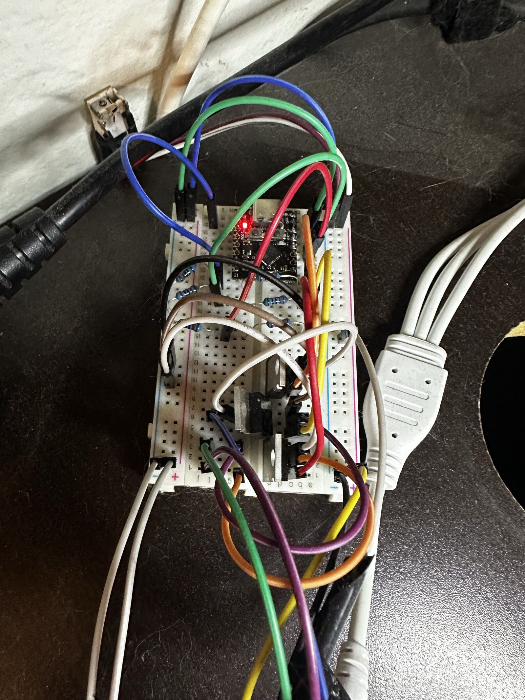

## Overview 
I've had my cheap analog RGB LED strip controller (specifically a "610+MIC+IR-V05" board) for about 6 years until it finally burnt out recently.
Instead of buying another $8 board destined to die the same way, I thought to myself, why not try and rebuilt it
from some relatively cheap parts I could find easily online?

All I needed was an **ESP32-C3**,
3x **IRLZ44N** logic-level MOSFETs,
and a **Mini360 (MP2307)** buck converter.
My goal was simple: get back the one feature I actually used from the original:
BLE-based RGB control from my phone.

## Parts
- ESP32-C3 SuperMini (Any dev board works; I just needed something small)
- 3× IRLZ44N N-channel MOSFETs (One per RGB color channel)
- Mini360 / MP2307 buck converter (12V --> 5V)
- Small Breadboard
- Bunch of Jumper Wires
- 3× 220 Ω gate resistors
- 3× 10 kΩ gate pulldown resistors
- 12V power supply (reused original power supply)
- Common-anode analog RGB strip (4 wires: shared +, and R/G/B returns)

## How it works
The strip is **common-anode analog**, one shared 12V line, separate R/G/B
return wires. Each color channel is one IRLZ44N wired as a **low-side switch**:
the strip's color wire goes to the MOSFET drain, source to ground, and the gate
to an ESP32-C3 PWM pin through a 220 Ω resistor, with a 10 kΩ pulldown from gate to
ground. The PWM dims each color which means I can mix the three colors, giving me my full-spectrum color back.

Power: The 12V supply feeds the strip's `+` rail directly and also feeds the
Mini360, which I stepped down to **5V into the ESP32's 5V/VBUS pin** (Not 3V3! I let the board's own regulator make 3.3V).

## Firmware
Originally I was looking for a project similar to [WLED](https://github.com/wled/WLED/) (For those who don't know, WLED is a free and open-source software for ESP8266/ESP32 microcontrollers that lets you control addressable LED strips and other lighting setups from a mobile app), but WLED is primarily built around UDP, meaning WiFi, which for my setup would not work. I found a few brave souls who forked the originial WLED project and were trying to convert it to a BLE stack, however [development](https://github.com/johne/WledAppV2) seemed to have haulted on it back in 2022.

Because of the lack of an in-development ESP32 BLE Analog RGB Controller firmware, I decided to break out PlatformIO and write it myself. I chose, of course, to write **BLE-only** firmware (no WiFi, so no radio contention on the C3). I chose to control the color via exposing solid color, master brightness, and a couple of effects (rainbow cycle
and color breathe) as 3 separate BLE characteristics, which then allows me to use any generic BLE app (I chose nRF Connect on iOS) to communicate with the controller.

Even though the simpler solution would've been flashing WLED, which supports analog/PWM output and is basically a
software clone of the original board, I wanted real BLE control and the practice of writing the firmware myself.

## What broke / what I learned 
- **The 3.3V gate-drive caveat:** the IRLZ44N is logic-level, but its on-resistance
  is spec'd at 5V gate drive, not 3.3V. At my strip's current (~1–3A/channel) it
  sits comfortably in its ohmic region and runs cool. For longer/doubled strips
  pulling more current it'd need a heatsink or a proper gate driver.
- **GPIO choice matters on the C3:** avoid strapping pins (2/8/9), the native-USB
  pins (18/19), and the default UART pins (20/21). I used GPIO 3/4/5 for R/G/B.
- The 10 kΩ pulldowns hold the MOSFETs off during boot/reset/flashing so the
  strip doesn't flash on unexpectedly.
- The IRLZ44N's I bought have a metal tab on the back (TO-220 style) and is the drain, which led to any single color I
  would set would come back white. I fixed this by spacing them out on my breadboard + slighly bending the 3 legs of the middle gate backwards.

## Result
I have restored my full RGB control-over-Bluetooth from my phone functionality, on hardware I built and software I wrote.

  
This is what the controller looks like fully exposed. I'm planning on giving it an enclosure but for now I'm prioritizing other projects :)

## Potential Future Upgrades
- I could implement a mobile app (or use one that already exists) to better control the RGB values rather than having to type the value out. Adding a slider or visual aid at the minimum would make the whole UI a lot cleaner.
- If I were to ever get a digital LED strip I could restart the project but with much more control.