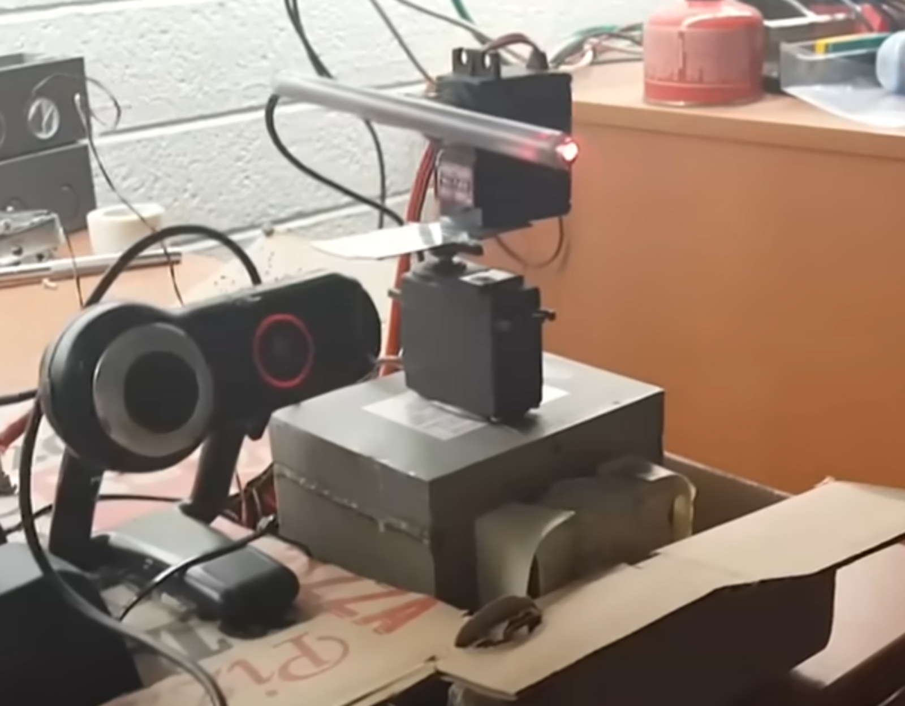
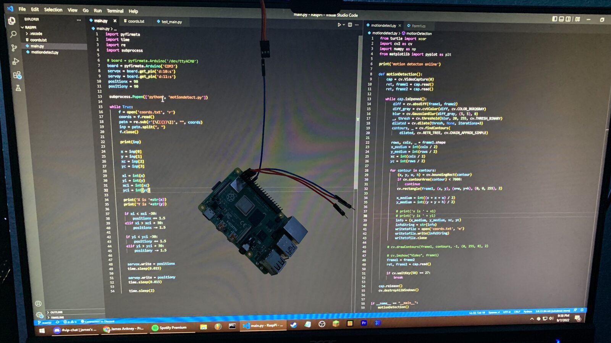

> **To preface this post:**
> This is what I would consider to be my first project ever, started and finished at 15 years old.

I did this project back in 2022, and it wasn't a personal idea of mine, but a guide from my favorite YouTuber at the time, [Michael Reeves](https://www.youtube.com/@MichaelReeves/). His YouTube channel debut, "[The Robot That Shines a Laser in Your Eye](https://www.youtube.com/watch?v=Q8zC3-ZQFJI)," was easily one of the funniest uses of python code in 2017. Later that year, he would release, "[DIY Laser Turret | Part 1 The Hardware](https://www.youtube.com/watch?v=ZpdvnHVIeyI)," and, "[DIY Laser Turret | Part 2 The Software](https://www.youtube.com/watch?v=_P24em7Auq0)," which were the tutorials I had followed at the time. I'll leave the link to [his original Bitbucket here](https://bitbucket.org/mtreeves808/face-detection-laser-system/src/master/). Credit is always due where it is deserved :)

The reason I decided to include this as a project (and call it my first project) is because I didn't clone the source code, instead I used it as inspiration for my own. 

The unfortunate truth of this story is, I did not get any good pictures or videos of the robot, and if you keep reading you'll find out why. Additionally, my original modified source code is lost to time, and I've reformatted my hard drive countless times since this project, so there is no hope of recovery :(

## Overview 
My webcam connects to my Raspberry Pi, which creates both X and Y axises based off of the camera bounds. Then, using the python library cv2 to continuously capture frames from the webcam stream, I take 2 frames from the stream and compare them. Any difference between the frames would be marked as the area of interest, and that targeted area will then find the coordinate in the middle of the contour. The X and Y coordinates are then sent to the servos via the on-board GPIO, which then move the laser to the area that has moved. 

## Parts
- Raspberry Pi 4B (4GB, RaspiOS)
- 2x MG996R Servo Motor (Looking back, a bit overkill for this project haha)
- Logitech C920 Webcam
- Bic Ballpoint Pen
- 5mW Laser Diode 
- Can of Soup

## How it works
The Raspberry Pi was the heart of this project. The webcam connected to the Raspberry Pi over plain USB, which was then processed through a python script I wrote running on top of Raspberry Pi OS. I only needed 2 axis movement, which led me to a two servo design. The bottom servo (super glued to a can of soup for weighted base) controlled the X axis by rotating the second servo (super glued to the first) which is holding a Bic pencil with a laser diode inside of it on its side for the Y axis.  

  
Credit: [Michael Reeves](https://www.youtube.com/@MichaelReeves/): [The Robot That Shines a Laser in Your Eye](https://www.youtube.com/watch?v=Q8zC3-ZQFJI)

## Firmware
The python script was fairly simple. I used pyfirmata to communicate with the GPIO pins on the Pi, and cv2 for image processing. It detects motion by taking two frames from the webcam back to back, running some color manipulation (for better results), and then compares the two seperate contours to find where something has moved or has changed. It then takes the coordinates of the center of the detected movement contour relative to the camera frame and saves them to a file. A second script them takes those two coordinates and sends them to the respective two servos via the GPIO. It would sleep and repeat this process until interrupt.  

Here is the single image I was able to recover of some of the source code and my Raspberry Pi hanging from a servo. (I know it looks like a full source code release in the photo but I don't know in what stage of development I was in, and considering how the Pi is hanging by a thread, I probably was too.)

## What broke / What I Learned 
The Raspberry Pi's 5v rail alone could not power itself, the laser diode, and the two servos. I was facing an issue where the Pi would brownout and restart, which I had initially assumed was due to a critical fault in my own code, not a voltage issue.

Additionally, I'd like to note that the Raspberry Pi 4B has a mighty processor for its size, but especially without proper cooling, it had its limits with the speed of the laser position updates. Something I could have done though is remove RaspiOS and use RaspiOS-Lite instead (which in turn would be stripping all of the unnecessary GUI from the Pi to give it more headroom).

Unfortunately, while I was displaying the project to not only my brother, but my mom and dad too; the Pi decided to make the Y axis look all the way down, making the whole stack pop off of the soup can and fall to the ground to shatter into a million pieces.

## Result
A cool little motion tracking laser turret with 2 axis movement that only had the chance to live a little under 24 hours.  
In all seriousness: I totally could have rebuilt the turret; nothing was stopping me, but I was also still in my sophomore year of high school, so I didn't.

## Potential Future Upgrades
I thought about bringing something like this back as a fun/funny project, but I would definately add more to it and expand on the platform. After following Reeves' tutorial and making up some of my own code, I always thought of making it more like the laser guns that Edna Mode from The Incredibles had outside of her lab (lol).  
But I have to say, the biggest threat to that idea was making one of the Aperture Science Sentry Turrets from Portal and Portal 2. Loading it up with a bunch of their voicelines would be golden.