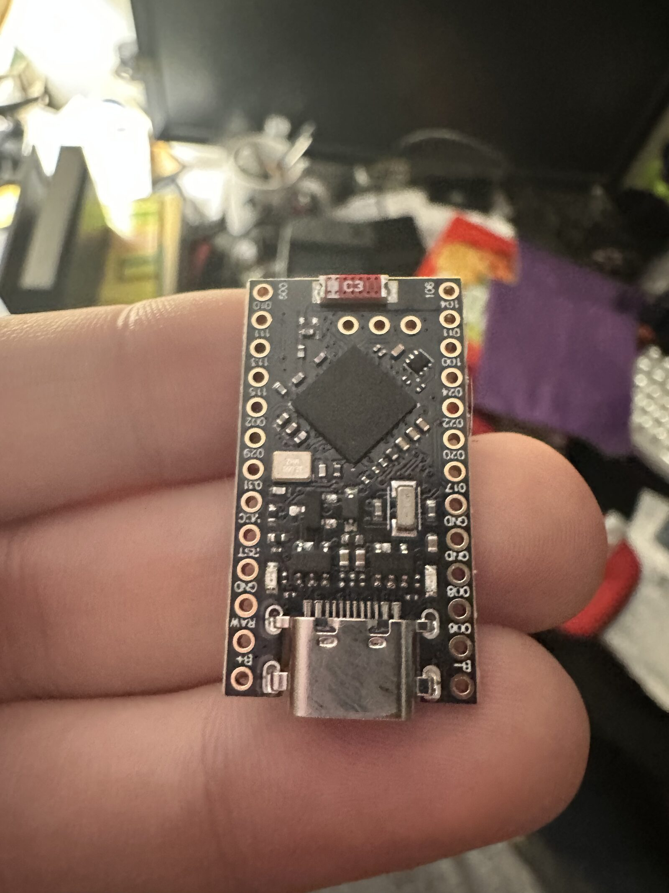
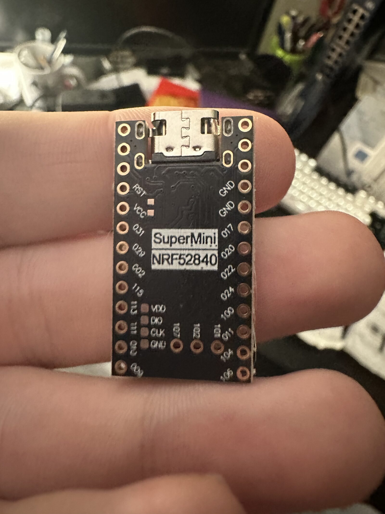
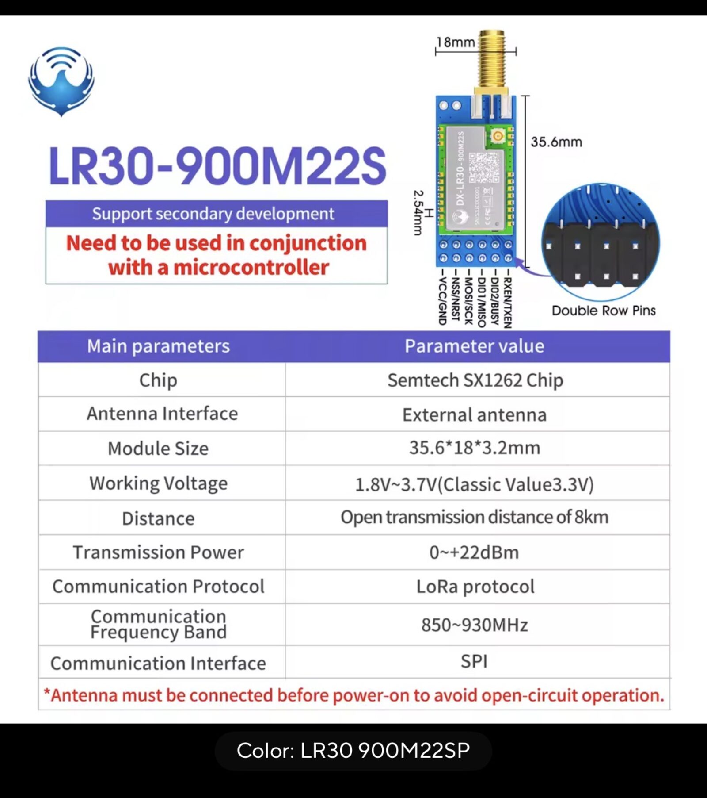
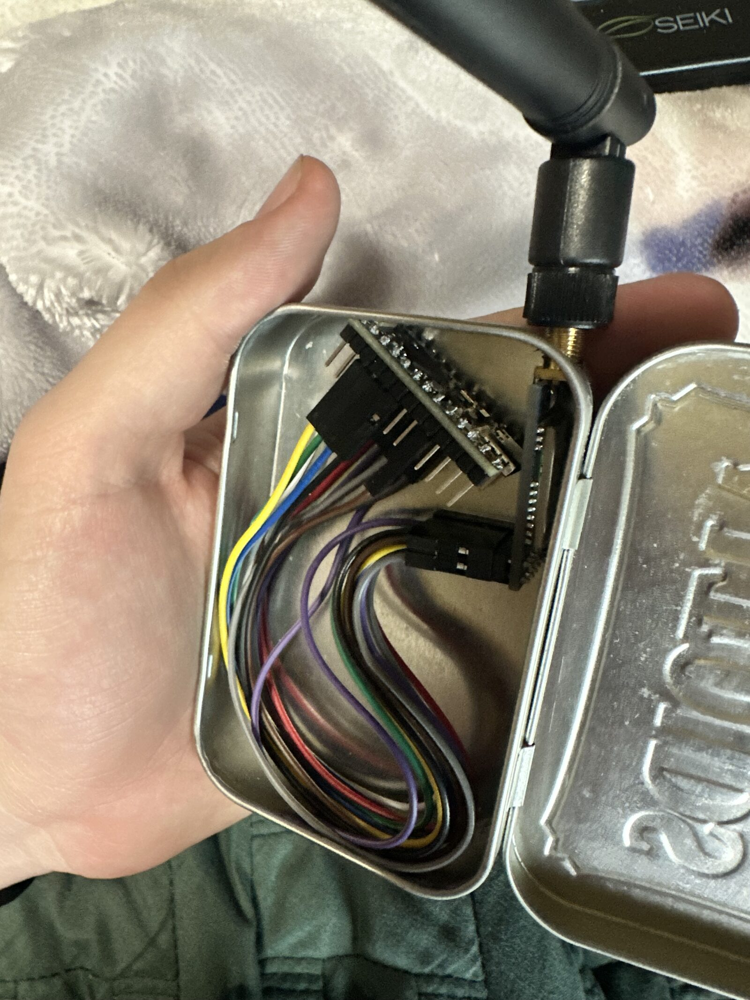
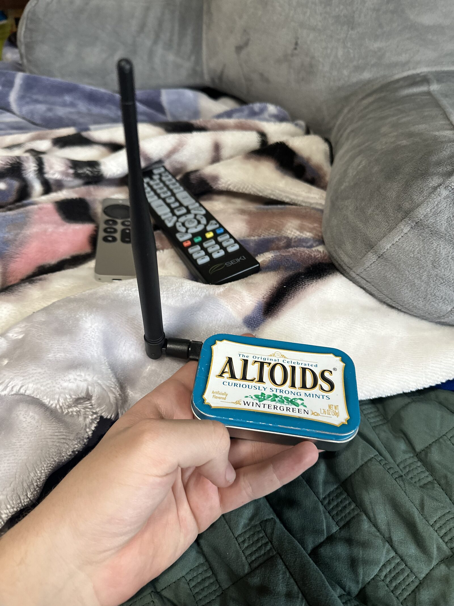

> **Before reading this post:**
> This article is written assuming that the reader already has a basic understanding of [Meshtastic](https://meshtastic.org/), [Meshtastic Nodes](https://meshtastic.org/docs/overview/), and the [Meshtastic Protocol](https://meshtastic.org/docs/getting-started/).

## Overview
I wanted to create a BLE-based mobile [Meshtastic](https://meshtastic.org/) node from scratch, and it went over quite the many iterations before it got to where I'd call V1.0. It started with a basic microcontroller + LoRa radio in an Altoids container and later developed into a full blown mobile platform for development. By adding a single buck converter and GPS module, the node now just needed a power source (which I acquired from tapping a fuse in my car) rather than a USB connection.

## Parts
##### V0.1  
- nRF52840 MCU (I chose this board because of its ultra-low idle current)
- DX-LR30 LoRa Module (SX1262, I used RXEN/TXEN instead of DIO2 as switch)
- Altoids Tin (Used as chassis)

##### V0.2
- nRF52840
- DX-LR30
- u-blox NEO-M8N GPS Module
- Mini360 / MP2307 buck converter (14V/12V --> 5V)
- Gefen VGA to DVI Scaler Plus (All internals removed, just used as a chassis)

##### V1.0  
- nRF52840
- DX-LR30
- NEO-M8N
- XL4016 Buck Converter (14/12V --> 3.3V)
- Samsung BD-E5400 (All internals removed, just used as a chassis)

## How it works
#### V0.1
I started this project by researching what hardware would fit my use case the best. For this project and its mobile (vehicle-based) nature, I was looking for a microcontroller that uses the least amount of power yet still has plenty of capability for the node itself.

This led me to the nRF52840, which is a multi-protocol System-on-Chip (SoC) designed for short-range wireless applications particularly with support for Bluetooth 5.3. It features a 64 MHz ARM Cortex-M4 processor, 1 MB of Flash memory, and 256 kB of RAM, making it suitable for many different kinds of complex applications.  
Specifically, I chose the "SuperMini" clone of the nRF52840 due to it being a solid, semi-well documented clone of the original chip at a fraction of the price.

My SuperMini nRF52840 (nRF52840 Clone) top-down
  
My SuperMini nRF52840 bottom-up
  
And for the LoRa Radio chip, I wanted the SX1262 due to its improved performance over the previous generations of the SX12xx chips. Specifically, I chose the DX-LR30 which is just the bare SX1262 IC on a dev board.

My DX-LR30 Datasheet
  
With these two components alone, I was able to create a mockup of the V0.1 mobile node. The hardware and wiring was fairly simple, especially since it was __powered via USB__. The firmware, however, was where I had the most trouble.  
After approximately a month of on and off working on the firmware (due to my Uni classes, I was unable to spend a meaningful amount of time each week working on the firmware, which is why it took such a large amount of time) the node powered up and was able to cleanly communicate between the MCU and the radio chip.  
Due to the simple nature and small size of the V0.1 mobile node, I was able to fit it into a modified Altoids tin with no problems.

V0.1 Mobile Node Open
  
V0.1 Mobile Node Closed
  
At this point, the mobile node just worked, no questions asked. I was able to text and receive messages like anyone else on the network, but I knew that I couldn't stop there. Due to the sheer amount of [Meshtastic supported Telemetry sensors](https://meshtastic.org/docs/configuration/module/telemetry/), I wanted to add more to the node to move away from such a basic configuration (limited to basic sending/receiving of messages,) to something that has sensor data that is useful to me and my friends.

Which led me to:
#### V0.2
This version added a u-blox NEO-M8N to the previous version (nRF52840 + DX-LR30), which unfortunately was a little more in depth than I thought. This is where the Altoids tin began to prove to be a problem, because even though I was able to actually fit everything inside of the tin, the thermal conditions as well as the interior conductivity of the enclosure led to me ditching it as the enclosure. Additionally, a sealed Altoids tin acts like a Faraday cage and kills GPS reception, and while I could have modified the Altoids tin further, I decided against it.  
What I used instead was a Gefen VGA to DVI Scaler Plus, or more specifically, the shell of a Gefen VGA to DVI Scaler Plus. It gave me the interior room for the GPS module and moved the whole build off of "cram it into a tin" and toward something that could actually live in the car. At this point, everything is connected, in its new chassis, and waiting for power. However, that is exactly where things get difficult.

Photo of my Gefen VGA to DVI Scaler Plus shell  
  
Since the node was no longer able to be powered via USB:  
(5V/1A should in theory be enough to power the nRF52840, DX-LR30, and NEO-M8N, but my NEO-M8N has a battery backup, so the MCU startup draw, DX-LR30 startup/transmit draw, and NEO-M8N startup/charging battery backup draw was too much for my 5V laptop USB rail.)  
I needed to re-engineer the power source. Luckily for me, cars already make their own electricity, so I just needed to find a way to tap an internal power rail in my car. At first I was going to tap the 12V accessory fuse because my dashcam has no problem turning on/off with the car, but upon further inspection, 12V was live at the fuse which forced me to find an alternative system with a shorter shutdown cycle. I sat out in the San Diego sun with my multimeter testing which fuses turn off with the car, which on an Audi with 7 shut-down cycles, can seriously take forever.  
After vigorous testing I found that my brake light sensor fuse rated at 5A turned on instantly with the car, and turns off ~5-10 seconds after the car is shut off. This was exactly what I was looking for, so I placed a fuse tap on it and ran a wire from the ground and fuse tap across my dashboard to the empty space on the passenger side dashboard.

Photo of the Fuse Tap  
  
Now that I had the power source, I needed a way to crunch down the incoming 12V to 5V. The nRF52840 and NEO-M8N both accept 5V in, but my DX-LR30 only accepts 3.3V. Keeping this in mind, I bought 10 of these Mini360 (MP2307) buck converters for pennies (10 PCS for $2.29 shipped, ~$0.23 per unit.) The Mini360 took 12V in and pushed 5V out, which when hooked up to the nRF52840 and NEO-M8N (DX-LR30 was getting its power via the 3.3V rail on the nRF52840,) allowed the node to start up when the car is running.

V0.2 Mobile Node  
  
From a passive standpoint, the node was finished. It automatically turned on/off with the car, logged GPS location, and overall just worked. This was all great until I tried to send a message (transmit via DX-LR30,) which made the whole system brown out and restart every chip. The only reason for this I can assume is that the Mini360 chips, given their miniature and mass-produced nature, were failing under load. I'd like to point out too that when the car is running it was outputting ~14V for the Mini360 to crunch down to 5V, which generates a lot of heat. On top of the generated heat, the node was living in my car that lives in the sun, making it easily 100F degrees at rest, which I believe led this chip to fail. Before giving up fully on the MP2307s, I tried using another Mini360 because I had so many, but it had the same issue of idling fine but under load just fully collapsing.

At this point, it was time to give up on the Mini360s for me. I bought a XL4016 buck converter but failed to double check the clearance of the chip + heatsink and compare it to the Gefen chassis I was using. This led me to:
#### V1.0
Finally, the final iteration of this first run of trying to make a mobile node. With the new XL4016 converting our 14V/12V to 5V, I was successfully able to transmit with no obvious drops in voltage.

XL4016  
  
Unfortunately, I had to change the chassis again because of the clearance issue. This led me to go to my local thrift store and buy a Samsung BD-E5400 Blu-ray player for $4.99, which after having all of its factory internals ripped out, became the new home for my mobile node.  
As I was designing my [Base Meshtastic Node](/projects/esp32s3-solar-meshnode/), I realized that my 5V rail coming from the buck converter was a huge engineering oversight on my part. As I briefly mentioned earlier, the nRF52840 and NEO-M8N both take 5V or 3.3V, while the DX-LR30 only takes 3.3V. They all share 3.3V input voltage, while they don't all share 5V in. By reducing the output voltage from 5V to 3.3V, I was able to power all 3 chips off of a single rail, whereas before the DX-LR30 was pulling its power from the nRF52840 3.3V rail (which could have been adding to the brown out failures from the V0.2 mobile node.)

Samsung BD-E5400  
  
As you can probably tell, this enclosure gave me much more room, but for the V1.0 of this project I just wanted to get the base node working. If I ever start working on a V2.0 for the mobile node, I will probably take advantage of all of the extra space internally.

## Firmware
Once V0.1 of the mobile node was alive, the configuration that actually worked was simpler than I thought. Thanks to the awesome Meshtastic community, writing your own custom firmware is fairly simple once you have a grasp on what it is you're really doing. If you're curious about the [custom Meshtastic firmware process](https://meshtastic.org/docs/development/firmware/build/), I'll leave a link [here](https://meshtastic.org/docs/development/firmware/build/). 

Key defines:
- `SX126X_DIO2_AS_RF_SWITCH` --> DX-LR30 does NOT use DIO2 for internal RF switching, instead just use RXEN/TXEN controlled by the Meshtastic firmware.
- Custom `NICENANO_SUPERMINI.json` board, courtesy of the hours of my life I'll never get back.
- Custom `variant.h` and `variant.cpp` for defining pins.
- Custom `variant.h` copied into the `promicro-nrf52840` variant so the build picks it up

Final wiring (DX-LR30 + NEO-M8N --> nRF52840 SuperMini):
| DX-LR30 pin | SuperMini pad | Port  | Function |
|-------------|---------------|-------|----------|
| MISO        | P1.15         | 47    | SPI MISO |
| MOSI        | P1.13         | 45    | SPI MOSI |
| SCK         | P1.11         | 43    | SPI SCK  |
| NSS/CS      | P0.02         | 2     | SPI CS   |
| DIO1        | P0.17         | 17    | IRQ      |
| BUSY        | P0.20         | 20    | BUSY     |
| RESET       | P0.22         | 22    | RESET    |
| TXEN        | P0.24         | 24    | TXEN     |
| RXEN        | P1.06         | 38    | RXEN     |
| Serial_1_RX | P0.10         | 10    | NEO-M8N_TX|
| Serial_1_TX | P0.09         | 9     | NEO-M8N_RX|
| 3.3V        | 3.3V          | —     | Power    |
| GND         | GND           | —     | Ground   |

Photo of working firmware  
  

If anyone would like to see the entire source for the meshtastic project, it's available [here on my github](https://github.com/jdankney/nicenano-supermini-meshtastic-firmware-v1).

## What broke / what I learned
The firmware was most of the battle. The board showed up over BLE just fine, but the radio would not initialize: the log kept throwing `critical error 3`, which is `ERRNO_RADIO_NOT_FOUND`. This means that the firmware literally could not find the SX1262 on the SPI bus. It turned out there wasn't one problem, there were four stacked on top of each other, and every fix just uncovered the next one.

1. **TCXO vs XTAL.** The variant I started from defined `SX126X_DIO3_TCXO_VOLTAGE 3300`, but the DX-LR30 uses a plain crystal (XTAL), not a temperature-compensated oscillator (TCXO). Telling the firmware to drive a TCXO voltage on a module that doesn't have one blocks radio init cold. Removing that define was step one.
2. **Variant registration.** My custom `variant.h` (`_VARIANT_NICENANO_SUPERMINI`) wasn't actually getting picked up by the build. I had to copy it into the `promicro-nrf52840` variant so the build system would use it.
3. **A physically shorted MISO.** Somewhere in the wiring I had a shorted MISO line. This is the part that makes you feel insane, because you sit there staring at firmware config convinced it's a software problem while a solder bridge quietly makes the whole thing impossible.
4. **RF switching.** The DX-LR30 may or may not actually have DIO2 internally to switch between receive and transmit, but I couldn't get it to work with the firmware for the life of me. Defining `SX126X_DIO2_AS_RF_SWITCH` as false and using RXEN/TXEN instead was the piece that finally brought the radio fully online.

Before any of that, the single most useful thing I did was prove the hardware in isolation. I wrote a tiny standalone sketch that just does a SPI `GetStatus` (`0xC0`) register read on the SX1262. Getting back a response that wasn't all `0xFF` or all `0x00` meant the chip was alive and reachable on the bus, which told me the problem lived in firmware config and not in a dead radio. That one test saved me from chasing ghosts through the config for another week.

The boot that finally worked read `SX1262 init success`, immediately pulled in and rebroadcast a real message off the mesh, and ACKed a test "Hello." After a month of on-and-off debugging, watching it relay a live packet on the first clean boot was genuinely one of the better moments of the whole build.

## Result
It works. The node is on the mesh with GPS, paired to the iOS app over BLE, and living in the Audi powered off a tapped fuse instead of a USB cable and a pile of separate converters. I can text and receive on the mesh from the car, and it reports position while it's out driving around, which was the whole point.

Final Product  
  

## What's next
The open question is power management with the ignition off. Right now it runs off a tapped fuse, so I need to decide whether to let it sleep hard when the car is off or tap a different fuse to keep it alive as a stationary relay while parked. The nRF52840 helps a lot here since the idle current is under ~5 mA, so keeping it alive is cheap, but I still want to confirm the tap is clean and won't drain the car battery over a few days of not driving.

Additionally, related to the power, I want to get a AMS1117-3.3, which is a linear 3.3V regulator. This would be a safeguard between the XL4016 and the chips themselves because the potentiometer on the XL4016 was extremely sensitive to the touch, so in theory if I went over a hard enough bump it could spin the pot to 7V+ with one nudge which would fry all 3 of my chips. If the XL4016 takes 14V/12V --> 5V, then the AMS1117-3.3 takes 5V --> 3.3V, it could provide a safe and steady current to the node. 

Apart from architecture upgrades, I wanted to take the node to the next level by adding more sensors and more overall devices. When I revisit this project I will more than likely be adding a magnetometer, I2C LED, more I/O, as well as two respective temperature and power monitors for more easily accessible real time data from the device.